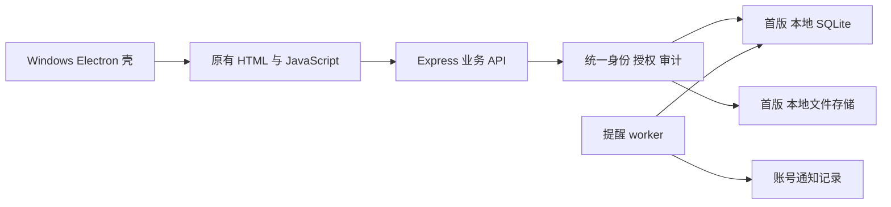

# 后续云端化兼容性与迁移约束

日期：2026-11-03，修订 0.2。案卷后续云端部署明确保留；首版只预留必要边界，不开发云部署、跨设备访问或远程连接界面，不联系 IT。首版仅在同一 Windows 系统账号环境使用。

## 1. 保留当前结构的可行性

案齐前端通过 HTTP `/api` 访问 Express，桌面主进程负责启动服务和加载网页，案件文件通过服务端接口读取；这给后续把业务服务部署到服务器提供基础。但 API 基址、认证、文件路径和数据库驱动仍带有当前部署假设，现有 change_log 的 origin/synced_at 元数据也不代表已有同步器。[A01–A03、A05、A10、A15]

建议分离职责保持为：页面负责交互，Express 负责身份/授权/业务，存储层管理附件，SQLite 负责本机持久化，Electron 负责生命周期和原生能力。首版不引入微服务、分布式队列、通用 ORM 或完整双数据库适配器。

未来桌面端和浏览器连接同一远程 Express API；数据库与文件均由服务器统一管理。采用集中式服务，不实现本地离线双写同步。未来远程模式的客户端需要受控停止本地后端，避免本机/远端数据源混淆。

## 2. 现在应落实的最小约束

| 边界 | 首版需要 | 首版不做 | 后续收益与限制 |
|---|---|---|---|
| API | 身份和权限只在服务端；统一错误/冲突协议；前端 API URL 构造集中 | 远程 URL 配置页、CORS 通配、云登录 | 将来换服务地址时保持业务规则一致；普通网页可同源部署 |
| 桌面接口 | 业务页不直接读 SQLite；原生打开文件等通过窄 preload 接口 | 页面任意执行本机命令 | 网页端可降级下载，业务仍可复用 |
| 用户 | 不可变用户 ID、停用与会话撤销；不以 Windows 登录名当业务身份 | AD/SSO、多租户、复杂组织架构 | 账号可迁移；远程上线须全部重新登录 |
| 业务数据 | 保留原主键并记录 schema；事务/乐观锁/幂等；时间语义明确 | 全表改 UUID、提前全面重构 SQL | 将来 ETL 可保持 ID 或做映射；SQLite 方言仍需迁移工作 |
| 附件 | 存储接口如 read/list/writeUnique；业务保存相对存储键/摘要/大小 | 对象删除/隔离区/恢复、S3 实现、预签名 URL 控制台 | 将来新增后端；不得暴露本机绝对路径给远程客户端 |
| 提醒 | worker 与窗口解耦；账号通知和共享来源分离；可恢复调度状态 | 服务器邮件/推送/服务安装器 | 将来调度器可独立常驻，但届时要增加单执行者/租约机制 |
| 备份 | 数据库、附件、必要密钥/配置、版本 manifest 成套 | 在线热迁移、跨机同步 | 迁移可先停写、导出、校验和切换 |
| 功能开关 | AI、IM、外部桥接服务端关闭且可验证 | 提前清除整个模块/引入云功能 | 保留上游同步空间，防止默认联网 |

这些是约束和拟新增接口，并非现有完整实现。应按实际改动点集中少量函数，不为未来替换把每个 SQL 查询包装成无意义的接口。[A03、A10–A18]

## 3. 数据兼容纪律

现有日期多数为北京时间日期或无时区字符串；sessions/部分提醒使用 UTC，不能全局自动转时区。法定日期保留 `YYYY-MM-DD`；新的审计/会话/调度时刻使用明确 UTC，显示转换到 Asia/Shanghai；旧字段按原语义导入并在 manifest 标明。迁移验证覆盖起算、跨日、顺延、人工覆盖和节假日年度缺失，不重新解释日期。[A03、A12、A20]

数据库当前大量 SQLite 专用 SQL、同步 better-sqlite3、触发器和 `lastInsertRowid`。未来选择 PostgreSQL 时需要明确移植 DDL、约束、事务、触发器、排序/大小写规则和货币数值；不能承诺仅改连接字符串即可迁移。首版避免新增与业务无关的 SQLite 特性，仍可使用适当的事务和约束。

附件目前是案件夹中的文件，相对路径还可能来自外部手工文件。迁移前须扫描实际文件与登记表：区分已登记、未登记、丢失、重名、大小写冲突和临时对象；对无法判定的对象报告，不自动删除或忽略。首版不建立对象隔离区，但要完整保留原有历史文件。文件散列与数量/大小核对一致后才能切换。精简律师费新增字段、历史复杂财务表和审计也需成套迁移，不因首版隐藏界面而丢弃。

## 4. 未来迁移步骤（仅设计）

1. 单独确认服务部署、数据库、存储、域名/TLS、源码提供方式和提醒通道；先搭虚构数据环境，不迁真实资料。
2. 在本机停写并完成整套备份；记录应用、上游、本地 schema、用户和附件 manifest。源数据保留，旧系统停止写入。
3. 导入服务端数据库，保持稳定用户/业务 ID 或生成可审计映射；复制文件及必要密钥，校验外键、计数、摘要、审计和日期。
4. 让 Windows 和浏览器对同一远程服务做权限、并发、文件、提醒验收；全部旧 Session 作废。仅启用一个调度器，不让本机与服务器重复发提醒。
5. 用户验收后切换；失败则按切换前整套副本回退。切换后如产生新写入，必须先保全新写入并另行决定恢复路线，不能直接覆盖回滚。

无论未来采用哪一种数据库，数据库和案件文件都必须成套迁移。禁止用共享 SQLite 文件替代业务 API，禁止未经批准让本地端监听 `0.0.0.0`。

## 5. 留待云端阶段的工作

远程认证/TLS、部署和升级、数据库迁移工具、对象存储实现、服务器单执行者调度、远程通知通道、在线监控、公司安全策略与跨设备体验均需单独立项。本轮不联系 IT、不准备服务器、不部署任何云资源。AGPL 网络源码取得入口也在远程交付阶段验收，义务分析见报告 01。
